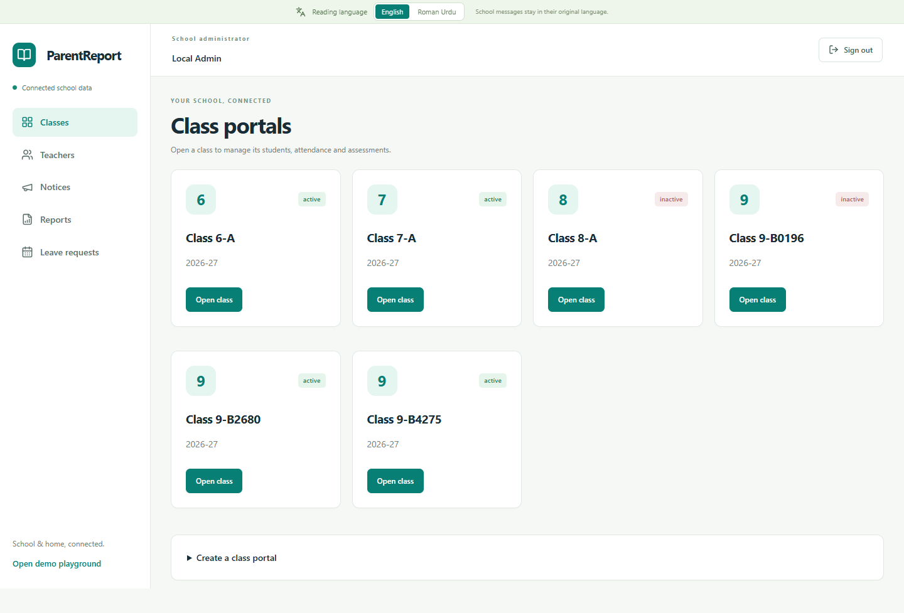
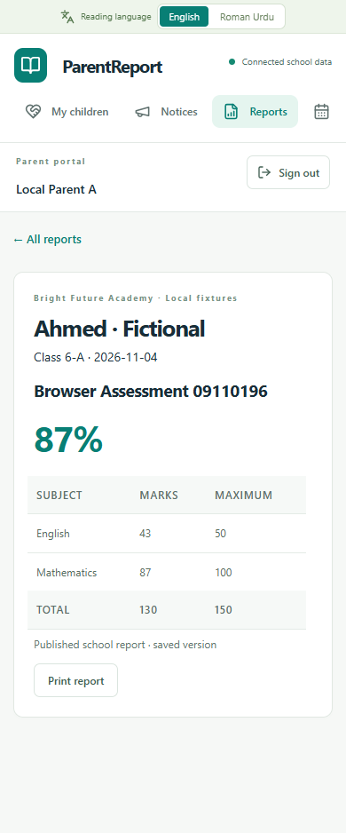

# ParentReport · School Report Cards and WhatsApp Notifications

ParentReport is a full-stack school reporting portal for Pakistani schools and academies. Teachers publish results from a class workspace, guardians read their own children's records, and administrators manage school access. The interface supports English and Roman Urdu.

**Stack** · React · TypeScript · Vite · FastAPI · PostgreSQL

[Try it locally](#run-locally) · [How it works](#how-it-works) · [Verification](#verification)

## Product walkthrough

| School admin | Parent on mobile |
| --- | --- |
|  |  |
| Create and activate class portals, assign teachers, and manage school branding. | Read published marks and report history for linked children. |

1. **Set up a class.** Assign a teacher, then add students manually or preview and import a CSV roster.
2. **Link guardians.** A class invitation collects a contact. The guardian verifies the number separately and decides whether to opt in to WhatsApp updates.
3. **Publish an assessment.** Enter subject marks and publish report snapshots. Guardians use a separate portal for reports, attendance, and notices.
4. **Review delivery.** Staff see eligibility, skip reasons, and notification history. The local worker can simulate delivery, retry, and failure with fictional accounts.

## How it works

| Layer | Implementation |
| --- | --- |
| React workspace | Separate admin, teacher, and parent flows, a mobile parent portal, and a Remotion tour |
| FastAPI | Session authentication, CSRF checks, class-scoped actions, and typed request validation |
| PostgreSQL | Row-level access policies, transactional roster imports, published snapshots, and durable queues |
| WhatsApp integration | Guardian OTP and consent, idempotent queueing, send-time eligibility checks, and signed Meta callbacks |

The demo runs locally with fictional data. The Meta live pilot is configuration-gated and was tested with mocked provider traffic. Live delivery and public deployment have not been verified.

## Run locally

### Quick demo

From the repository root, with Node 20.19+ and npm:

```sh
cd frontend
npm install
npm run dev
```

Open the Vite URL and choose a demo role, or open `/tour`. This mode runs in the browser without PostgreSQL or Meta credentials.

### Connected workspace

Follow the [Windows PostgreSQL setup](backend/README.md) and [FastAPI quick start](backend/API.md), then open `http://127.0.0.1:5173/workspace`. The setup creates fictional login accounts in the ignored `backend/.local/accounts.json` file. To try parent onboarding and the local queue, see [WhatsApp simulation instructions](backend/WHATSAPP.md).

## Verification

The live pilot change was checked against mocked Meta traffic. **31 targeted backend tests, 49 frontend tests, 50 database permission checks, and 16 local onboarding browser checks passed**, along with the frontend production build. The checks covered consent withdrawal, report isolation, OTP replay prevention, uncertain provider responses, and signed delivery receipts.

[Frontend verification](frontend/verification/RESULTS.md) · [API reference](backend/API.md) · [Production pilot runbook](backend/deploy/PILOT.md)
